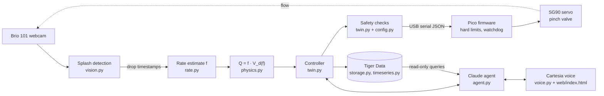

# DripTwin

**DripTwin turns a standard gravity IV set into a rate-controlled infusion: pump-like control for clinics that can't afford pumps.**

Built at **Cal Hacks 13.0** (UC Berkeley, October 2026). A research prototype tested with water. **Not a medical device.**

## Demo

▶️ Demo video: _link coming soon_

## What it does

- **Counts drops with a webcam.** Each drop is detected from the splash it makes in the drip chamber (OpenCV).
- **Measures flow, not just drops.** Drop size grows with drip speed, so drops are converted to mL with a drop-volume curve measured on our own 20-drop set: $V_d(f)$.
- **Holds the ordered rate with a servo pinch valve.** A closed-loop controller moves a 3D-printed pinch valve on the tubing until the measured flow matches the order, then holds it.
- **Safety layer.** Hard limits on orders and valve motion, free-flow, occlusion and empty-bag detection, and a firmware watchdog. The AI has no valve control.
- **Voice agent.** Claude takes orders, reads them back and explains what the line is doing. Cartesia provides hands-free listening and spoken replies and alarms.
- **Tiger Data storage.** Every drop and the twin's state go into TimescaleDB hypertables with continuous aggregates. The agent queries them read-only.

## Architecture



| Module | What it does |
|---|---|
| `driptwin/vision.py` | Splash detection: finds the splash zone automatically, frame differencing, adaptive spike threshold, disturbance veto |
| `driptwin/rate.py` | Drop log and drop-rate estimate (median or mean of recent intervals) |
| `driptwin/physics.py` | Measured drop-volume curve, hydraulic model, measured valve table, bag-height ("head") estimator |
| `driptwin/twin.py` | The core: order → controller → diagnostics (bag moved, kink vs. empty bag, free flow, spoken warnings) |
| `driptwin/config.py` | All safety limits and tuning in one place |
| `driptwin/runtime.py` | Wires camera, twin, Pico, storage and agent together; loads the firmware into the Pico |
| `driptwin/server.py` | FastAPI server: live dashboard, voice endpoints, spoken alarms |
| `driptwin/agent.py` | Claude agent with a fixed tool set and an order confirmation gate |
| `driptwin/voice.py` | Cartesia: Sonic streaming TTS, Ink 2 access tokens, Ink-Whisper, pronunciation dictionary |
| `driptwin/storage.py`, `driptwin/timeseries.py` | Infusion log on Tiger Data (TimescaleDB), SQLite fallback |
| `driptwin/flowctl.py` | Hold a flow from the terminal on the real rig |
| `driptwin/valvecal.py` | Measure the valve: servo angle → drop rate → flow |
| `driptwin/groundtruth.py` | Record a video, mark drops by hand, score the detector |
| `driptwin/sim.py` | Simulated IV set and synthetic camera, to run everything without hardware |
| `firmware/main.py` | MicroPython on the Pico: servo, buzzer, hard limits, watchdog |
| `web/index.html` | Dashboard with live video, flow, events and the voice interface |

## Hardware

- **Camera:** Logitech Brio 101 webcam (640×480 at 30 fps), in a 3D-printed housing (PLA)
- **Backlight:** 2 white LEDs behind the drip chamber
- **Valve:** 3D-printed cam pinch valve (PLA) driven by an **SG90 servo** (GP15)
- **Controller:** Raspberry Pi Pico (MicroPython) over USB serial; buzzer on GP13
- **IV set:** standard gravity set, 20 drops/mL
- **No soldering was used.**

## Setup & run

```bash
python -m venv .venv
.venv\Scripts\pip install -r requirements.txt      # Windows (macOS/Linux: .venv/bin/pip)
copy .env.example .env                              # then fill in your keys
```

**Environment variables** (see `.env.example`): `ANTHROPIC_API_KEY` (Claude), `CARTESIA_API_KEY` (voice), `DATABASE_URL` (Tiger Data; without it the log goes to local SQLite) and `AGENT_DATABASE_URL` (the agent's read-only role). Optional: `GEMINI_API_KEY` (fallback agent), `CARTESIA_VOICE_ID`, `CARTESIA_TTS_MODEL`, `CARTESIA_ALARM_EMOTION`, `CARTESIA_PRONUNCIATION_DICT_ID`.

**Pico:** flash MicroPython onto the Pico and leave it **without** a `main.py`. The server and `flowctl` load `firmware/main.py` into the Pico's RAM over USB each time they start, and reset it on exit.

**Run it** (dashboard at http://localhost:8000):

```bash
python -m driptwin.server --sim                         # no hardware: simulated drip
python -m driptwin.server --monitor --camera 1          # webcam only: counts drops, no valve
python -m driptwin.server --port COM5 --camera 1        # full system: camera + Pico + valve + voice
python -m driptwin.flowctl 330                          # hold 330 mL/h from the terminal (drops read from a running monitor server)
python -m driptwin.flowctl 330 --camera 1               # ... or with the webcam directly
```

**Tools:**

```bash
python -m driptwin.valvecal --port COM5 --angles 40:90:2      # measure the valve -> valve_cal.json
python -m driptwin.groundtruth record --camera 1 --seconds 120 --name run1   # press SPACE at every drop
python -m driptwin.groundtruth eval recordings/run1.mp4      # recall / precision against your presses
python -m driptwin.selfcheck                                  # check the Claude and Cartesia keys
python -m driptwin.timeseries setup                           # create the Tiger Data schema
python -m driptwin.timeseries agent-role                      # create the agent's read-only role
python -m pytest -q tests                                     # tests (controller, detector, voice, storage)
```

## Cartesia

Voice is how the nurse uses DripTwin: hands busy and gloved, eyes on the patient. Orders are spoken and read back before anything starts, and alarms are spoken immediately.

| Cartesia feature | How we use it | Where |
|---|---|---|
| **Ink 2 streaming speech-to-text with turn detection** | Hands-free listening. The browser streams the microphone to `wss://api.cartesia.ai/stt/turns/websocket` and Ink 2 decides when the speaker has finished (tuned `turn_end_threshold` / `turn_end_timeout_ms`, plus keyterms for units, drug names and "confirm"). | `web/index.html` (hands-free), `voice.access_token()` |
| **Short-lived access tokens** | The browser gets a token from `/api/stt-token`, so the API key never reaches it and audio doesn't pass through our server. | `voice.access_token()`, `server.py` |
| **Ink-Whisper batch speech-to-text** | Push-to-talk fallback for noisy rooms: one recorded clip, one call. | `voice.transcribe()`, `/api/voice` |
| **Sonic streaming text-to-speech (WebSocket)** | One persistent WebSocket, one context per reply. Claude's text is spoken while it's still being written, so the first audio comes before the full answer. | `voice.stream_speech()` |
| **Generation config (emotion, speed, volume)** | A calm voice for answers, a faster, louder voice for alarms. | `voice.STYLES` |
| **Pronunciation dictionary** | Created once through the API and reused, for drug names and abbreviations (NS, LR, D5W, KCl…). Units like "mL/h" and "gtt/min" are also rewritten to words before speech. | `voice.ensure_dictionary()`, `voice.normalize()` |
| **Multilingual (Spanish)** | Replies and alarms in English, Spanish, or both. | `voice.LANGS`, `voice.alarm_lines()` |

**Spoken alarms and warnings** go straight from the device event to Sonic, with no LLM in the path: occlusion, empty bag, free flow, controller connection lost, flow far above target (with the model's bag-height estimate) and "nothing is dripping" (valve closed vs. line closed elsewhere).

## Claude agent & safety

The agent (`claude-opus-5-5`, `driptwin/agent.py`) can only call a fixed set of tools:

- **Infusion:** `propose_order`, `start_infusion`, `get_status`, `pause_infusion`, `resume_infusion`, `set_bag_height`, `log_note`
- **History (read-only, Tiger Data):** `get_flow_history`, `find_flow_gaps`, `get_time_to_empty`

**Claude never controls hardware.** No tool sets the valve. The controller sets it, and the firmware enforces limits the agent can't change. All numbers (drops/min, mL per drop, durations) are computed in code and handed to Claude in the tool results.

**Read-back confirmation is enforced in code,** not only in the prompt. `start_infusion` is refused if it comes in the same turn as `propose_order`, or if the person's own words don't contain a confirm word ("confirm", "yes", "sí", "confirmo", …).

**Hard limits** (`config.py`, mirrored in `firmware/main.py`):

| Limit | Value |
|---|---|
| Order rate | 5–500 mL/h |
| Drop sets | 10, 15, 20 or 60 drops/mL |
| Volume to be infused | ≤ 3000 mL |
| Valve speed | ≤ 0.15 of full travel per second (firmware) |
| Valve travel | 40–90° servo range, never outside 0–90° (firmware) |
| Free-flow limit | > 180 drops/min closes the valve |
| Heartbeat | no message from the laptop for 3 s → firmware holds position and sounds the buzzer |
| Firmware watchdog | 2 s; the valve boots closed |

The twin also detects:
- **Free flow:** far too fast with the valve closed as far as the search allows.
- **Occlusion vs. empty bag:** when drops stop, the valve is opened briefly. A low bag responds; a kink doesn't.
- **Low bag:** valve wide open and still short of the target.

## Tiger Data

The infusion log lives in Tiger Data (TimescaleDB) when `DATABASE_URL` is set, otherwise in SQLite (`storage.py`). Writes go through a background queue, so a slow database never stalls the control loop.

- **Hypertables:** `drops` (one row per detected drop, with its calibrated volume) and `telemetry` (about one row per second from the twin), with 1-hour chunks.
- **Continuous aggregates:** `drops_10s`, `drops_1m`, `telemetry_10s`, `telemetry_1m`, with real-time aggregation. They're joined in the `flow_10s` and `flow_1m` views that the dashboard and agent read.
- **Columnstore compression** after 1 hour, and a **retention** policy that drops raw rows after 7 days while keeping the aggregates.
- **Gap detection:** `find_flow_gaps` uses `time_bucket_gapfill` to find 10-second windows with no drops (stalls and occlusions).
- **Time to empty:** `get_time_to_empty` divides remaining volume by current flow, and fits a `regr_slope` / `regr_intercept` / `regr_r2` trend through recent flow.
- **Read-only agent role:** `driptwin_agent` (`AGENT_DATABASE_URL`) has `default_transaction_read_only = on` and SELECT only on the flow views, events and infusions. It only runs fixed, parameterised queries, never free-form SQL.

## Physics model

Gravity drives the flow. The pressure at the cannula comes from the height $h$ of the fluid in the bag above it:

$$\Delta P = \rho g h$$

The line is modelled as $Q = (h - P_\text{ven}) / (R_0 + R_c(u))$, where $R_c(u)$ is the pinch valve's resistance at position $u$. The valve curve is measured on the rig (`valve_cal.json`). Working this backwards from the measured flow gives the implied bag height, which the twin uses to explain changes.

**Drop volume.** Measured on our 20-drop set, with $f$ in drops/s and $V_d$ in mL/drop:

$$V_d(f) = 0.06341 + 0.02416\,\frac{f^4}{f^4 + 2.688^4}, \qquad Q = f \cdot V_d(f)$$

**Control.** On the measured valve the controller is a feedback search rather than a fixed gain, because the valve has a sharp cut-off and hysteresis (the tube doesn't spring back the way it was squeezed):
- The valve table only gives the first guess.
- It keeps the last "too fast" and "too slow" valve positions and tries halfway between them.
- Every position is approached from the open side.
- It learns the tube's hysteresis while running.
- It reacts at once to sudden surges.

It holds once the flow is within ±5% of the target and corrects again beyond ±8%. Each correction waits for the drip chamber to settle (8 s) and for 16 new drops.

## Validation results

**Head-change test** (volume delivered in 40 s):

| | Runs (mL) | Mean |
|---|---|---|
| Baseline, passive | 3.00, 3.28, 3.08, 3.00 | 3.09 |
| Head raised 38.5 → 102.8 cm after 20 s, passive | 5.82, 5.87, 5.80 | 5.83 ± 0.04 (+88.7%) |
| Head raised 38.5 → 102.8 cm after 20 s, DripTwin | 4.0, 3.7, 3.8 | 3.83 ± 0.15 (+24.1%) |

→ **73% less over-delivery** than the passive gravity set.

**Drop detection:** 75/75 reference drops on a recorded clip, and 93/93 on the live rig. The references were automatic (whole-picture change events), **not manual counts**. A manual check can be made with `driptwin.groundtruth`.

## Known limitations

- **Research prototype, tested with water.** Not a medical device.
- **Servo precision:** the SG90's positioning resolution limits accuracy. Near the valve's cut-off, the flow changes faster than the servo can resolve, and the tube's hysteresis makes the flow drift at a fixed angle.
- **Calibration range:** the drop-volume curve and valve table cover only the range and bag-height configurations we measured.
- **No tilt sensing yet.**
- **Bag-height messages** (the "bag raised/lowered" explanations) are noisy on our rig, because tube sticking also changes the flow.
- **Voice not yet tested in real clinical noise or with varied accents.**
- **Voice and agent need the internet:** Claude and Cartesia are cloud APIs.
  - Without an Anthropic key the dashboard gives scripted status replies (or the Gemini fallback if configured).
  - If Cartesia streaming fails, alarms fall back to the browser's built-in speech.
  - Control and alarms themselves don't depend on the network.
- **Camera exclusivity:** only one program can use the webcam at a time. `flowctl` can read the count from a running monitor server instead.

## References

1. Simon et al., 2011. doi:[10.1007/s13318-011-0062-9](https://doi.org/10.1007/s13318-011-0062-9)
2. Horiuchi, 2020. doi:[10.1007/s42452-020-03448-w](https://doi.org/10.1007/s42452-020-03448-w)
3. Horiuchi, 2018. doi:[10.4286/jjmi.88.426](https://doi.org/10.4286/jjmi.88.426)
4. Park et al., 2025. doi:[10.2147/MDER.S495996](https://doi.org/10.2147/MDER.S495996)
5. Oh et al., 2025. doi:[10.17085/apm.25207](https://doi.org/10.17085/apm.25207)
6. Tadano et al., 2020. doi:[10.3390/app10031066](https://doi.org/10.3390/app10031066)

## Team

- _Name_ — _role_
- _Name_ — _role_
